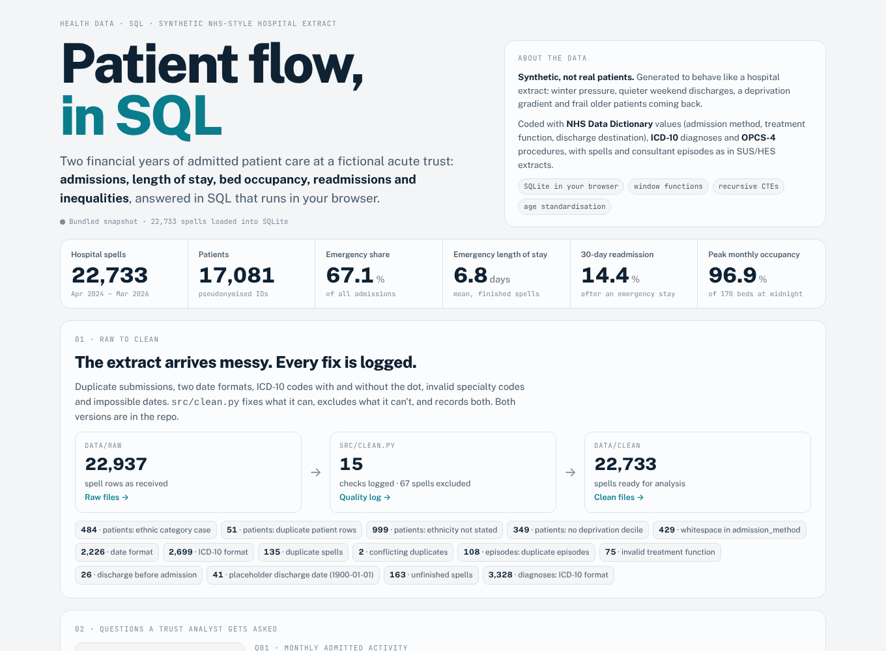
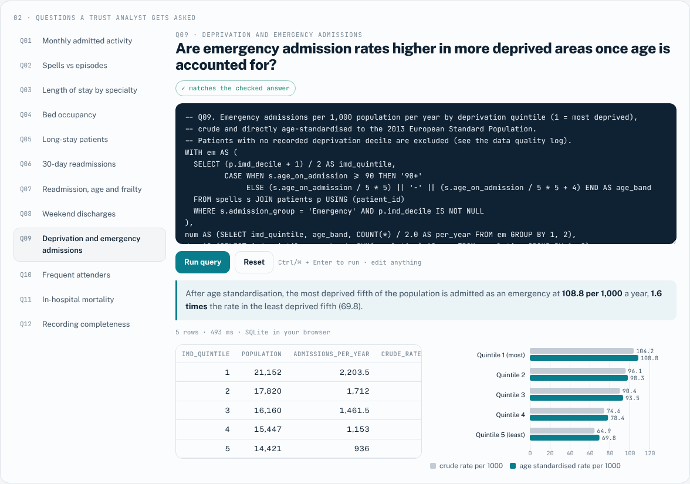
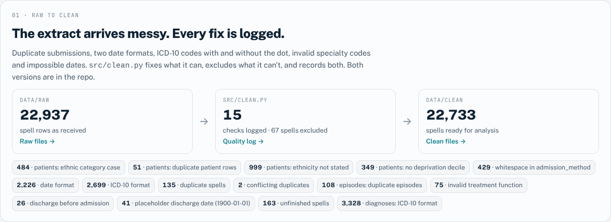
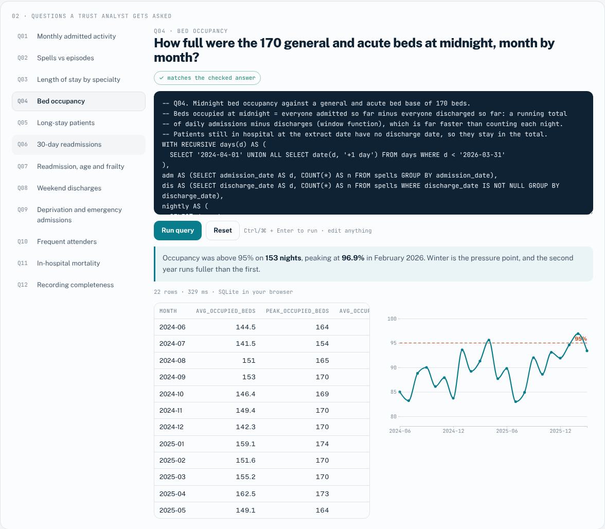

# Patient flow, in SQL

**Twelve questions a hospital trust analyst gets asked, answered in SQL on two years of NHS-style admitted patient care data. Covers admissions, length of stay, bed occupancy, readmissions and health inequalities. The raw extract, the cleaned data and every query are in this repo, and the queries run in your browser.**

Track: Health Data · SQL (SQLite), Python, pandas, D3.js, pytest · [Live SQL lab](https://qaisbello.github.io/health-data/patient-flow-sql/)



> **Synthetic data.** No real patient is represented. The extract was generated (`src/generate.py`) to behave like a real acute trust's data, with realistic patterns, coding and data quality problems, so it can be shared publicly.

## What the analysis finds

| Question | Finding |
|---|---|
| Activity | Emergency admissions run **13.3% higher in winter** (Dec–Feb) than in summer. |
| Spells vs episodes | Counting consultant episodes would overstate emergency admissions by **28%**: 23% of emergency stays involve more than one consultant. |
| Bed occupancy | Above **95% on 153 nights** against a 170-bed base, peaking at **96.9%** (February 2026). |
| Long stays | **13–25 patients** a night had been in hospital 21+ days, using 9–16.5% of occupied beds. |
| Readmissions | **14.4%** of emergency patients came back as an emergency within 30 days. For patients 85 and over it was **40.9% with dementia coded vs 25.1% without**. |
| Weekend discharges | Weekend discharges run at **58%** of the weekday level, so Monday is the busiest discharge day. |
| Inequalities | Age-standardised emergency admission rate: **108.8 per 1,000** in the most deprived fifth vs **69.8** in the least, a **1.6×** gap. |
| Frequent attenders | **5.9% of patients** (3+ emergency admissions in a year) use **29.8% of emergency bed days**. |



## Raw to clean

The raw extract in `data/raw/` arrives with the problems real SUS/HES-style extracts have. `src/clean.py` fixes what it can and excludes what it can't, and `data/clean/data_quality_log.csv` records every step.

| Problem in `data/raw` | Rows | What `clean.py` does |
|---|---:|---|
| Duplicate spell submissions | 135 + 2 conflicting | Keeps one; where copies differ, keeps the valid copy |
| Dates as DD/MM/YYYY instead of YYYY-MM-DD | 2,226 | Parses both formats |
| ICD-10 codes without the dot (J189 vs J18.9) | 2,699 spells, 3,328 secondary | Standardises to the dotted form |
| Trailing spaces in admission method | 429 | Trims |
| Invalid treatment function code (999) | 75 | Recovers it from the spell's first consultant episode |
| Discharge before admission | 26 | Excludes; listed in `rejected_spells.csv` |
| Placeholder discharge date 1900-01-01 | 41 | Excludes; listed in `rejected_spells.csv` |
| Duplicate patients / episodes, lower-case codes | 51 / 108 / 484 | De-duplicates, upper-cases |
| Patients still in hospital at extract date | 163 | Kept with no discharge date: counted in occupancy, left out of length of stay |
| Ethnicity not stated / no deprivation decile | 999 / 349 | Kept and reported (Q12), excluded only from the analyses that need them |

**Accounting check:** 22,937 raw spell rows, minus 137 duplicates, gives 22,800 unique spells. Of these, 22,733 are clean and 67 are rejected. A test enforces this.



## The data model

Mirrors an admitted patient care extract:

- **patients:** pseudonymised ID, sex, birth month and year, ethnic category, deprivation decile and GP practice.
- **spells:** one row per hospital stay.
- **episodes:** one row per consultant, i.e. finished consultant episodes (FCEs).
- **diagnoses:** ICD-10, primary and secondary.
- **procedures:** OPCS-4.

Codes follow the [NHS Data Dictionary](https://www.datadictionary.nhs.uk/): admission method (11/12 elective; 21, 22, 24, 2B emergency), treatment function (e.g. 300 General Internal Medicine, 430 Elderly Medicine), discharge method and destination. Reference tables decode every code.

Population denominators by age, sex and deprivation quintile support rates. The 2013 European Standard Population weights support direct age standardisation. See [`docs/data-dictionary.md`](docs/data-dictionary.md).

## SQL techniques shown

- **Window functions:**
  - Medians via `ROW_NUMBER()` (Q03).
  - Running totals for midnight bed occupancy (Q04, Q05).
  - A `RANGE BETWEEN 364 PRECEDING` window for frequent attenders (Q10).
- **Recursive CTE** calendar (Q04, Q05, Q08).
- **Correlated `EXISTS`** for 30-day readmissions with explicit exclusions: died, transferred out, and insufficient follow-up (Q06, Q07).
- **Direct age standardisation** to ESP2013 (Q09).
- **Handling unfinished spells** with `COALESCE` and `IS NULL` instead of dropping them, which would understate occupancy at the end of the period.



## Run it

```bash
pip install -r requirements.txt
python src/generate.py      # optional: rebuild the synthetic raw extract (fixed seed, deterministic)
python src/clean.py         # data/raw -> data/clean + data_quality_log.csv
python src/run_all.py       # run all 12 queries and check them against answers/expected.json
python -m pytest -q         # 6 tests
python build.py             # web/template.html -> web/index.html
```

Every result is also written to [`answers/results.md`](answers/results.md). The web page loads `data/clean/` into SQLite in the browser (sql.js), live from this repo, and marks each query ✓ when it matches the checked answer.

## Repo layout

```
data/raw/       the extract as received (messy)
data/clean/     analysis-ready tables, data_quality_log.csv, rejected_spells.csv
src/            generate.py · clean.py · run_all.py
sql/            schema.sql · q01–q12.sql · index.json
answers/        expected.json · results.md
web/            template.html → index.html (SQL lab)
tests/          test_pipeline.py
```

## Notes and limits

- Readmission here is a simplified definition: any emergency admission within 30 days of a live discharge, excluding transfers. National indicators add further exclusions.
- Crude mortality is not risk-adjusted. Fair comparison between hospitals needs a method like SHMI.
- The bed base (170 general and acute beds) and population are part of the simulation.

---

Built by [Qais Adeniji-Bello](https://qaisbello.github.io) · [LinkedIn](https://www.linkedin.com/in/qais-adeniji-bello/)
